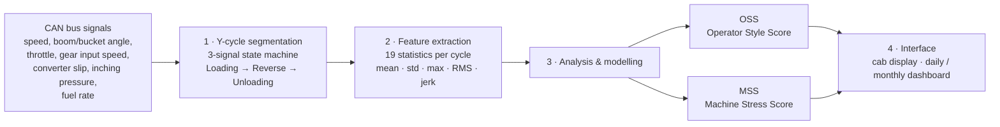

# From Driving Style to Machine Abuse
### An AI pipeline for wheel loader operation

**Author:** Simone De Giorgi
**Context:** Thesis project, *Corso di perfezionamento in Tecnologie Digitali per Ambienti e Sistemi Intelligenti*

---

## 1. Project overview

How aggressively a wheel loader is driven has a direct cost: safety risk, higher fuel consumption and faster wear of engine, transmission and brakes. All three effects leave a signature in the standard CAN signals that the machine already exposes.

The project turns those signals into **two complementary 0–100 indicators, computed cycle by cycle**:

| Indicator | Question it answers | Method |
|---|---|---|
| **OSS: Operator Style Score** | *How is the machine being driven?* | Supervised: cost-sensitive SVM (RBF kernel) + sigmoid calibration |
| **MSS: Machine Stress Score** | *What did this cycle cost the machine?* | Reference-based: deviation from **Normal** operation for fuel, engine, transmission and brakes |

The unit of analysis is the **Y-cycle**: load, reverse, unload. It repeats many times per shift with the same geometry, so two cycles can be compared like two repetitions of the same experiment.

**Key results** (full details in the thesis):

- 1,678 Y-cycles (1,571 Normal, 107 Aggressive, imbalance 14.7 : 1)
- 19 candidate features; 7 selected via mRMR + cross-validation
- The classes separate before any model is trained: PCA, K-means (k = 2), PERMANOVA (F ≈ 1500, p = 0.001, R² = 0.47), Hopkins H = 0.875
- Held-out test set: 100 % Balanced Accuracy (392 Normal / 27 Aggressive, zero errors); 5-fold CV on the full dataset: 1.000 ± 0.000
- OSS and MSS are correlated but not redundant (Spearman ρ = 0.75 on Normal cycles)

---

## 2. System architecture



| # | Stage | Input | Output |
|---|---|---|---|
| 1 | **Y-cycle segmentation**: a state machine on vehicle speed, boom angle and bucket angle detects the three phases and assigns a unique ID to each valid cycle | Continuous CAN trace | Segmented cycles |
| 2 | **Feature extraction**: 19 statistics per cycle covering kinematics, accelerator pedal, braking and inching/clutch | Segmented cycles | One feature vector per cycle |
| 3 | **Analysis & modelling**: separability tests, feature selection, cost-sensitive SVM, OSS, MSS | Feature table + segments | Per-cycle OSS / MSS, trained model, figures |
| 4 | **Interface**: cab display (OSS view / MSS view) and daily/monthly dashboard with per-operator filters | Per-cycle OSS / MSS | Feedback for operators and fleet managers |

Stages 1–2 prepare the per-cycle data. Stage 3 is the core of the project and is released in the **analysis repository**. Stage 4 is presented as a design concept in the thesis, the slides and the **presentation page**.

---

## 3. Component repositories

| Component | Repository |
|---|---|
| **Analysis & modelling (OSS / MSS): MATLAB code, thesis, slides** | **this repository** ([perfez-2526-DrivingStyleAnalysis-degiorgi](https://github.com/UniSalento-IDALab-corsoPerfez-25-26/perfez-2526-DrivingStyleAnalysis-degiorgi)) |
| Project presentation: web page (GitHub Pages) | [perfez-2526-presentation-degiorgi](https://github.com/UniSalento-IDALab-corsoPerfez-25-26/perfez-2526-presentation-degiorgi) |

**Project web page:** https://unisalento-idalab-corsoperfez-25-26.github.io/perfez-2526-presentation-degiorgi/

---

## 4. This repository: Analysis & modelling

### 4.1 Contents

```
.
├── README.md
├── code/
│   ├── DrivingStyle_MachineStress.m   # main script (whole pipeline below)
│   └── stats/                         # PERMANOVA (+ computeF), PERMDISP, Hopkins
└── docs/
    ├── Thesis_DrivingStyle_WheelLoader.pdf
    ├── Slides_DrivingStyle_WheelLoader.pdf
    └── Slides_DrivingStyle_WheelLoader.pptx
```

### 4.2 What the script does

| Step | Description |
|---|---|
| 1–4 | Load Normal and Aggressive feature tables and segments; drop mis-segmented cycles; merge datasets |
| 5 | Add the speed-jerk features (`JerkSpeed_mean`, `JerkSpeed_std`) computed from the raw segments |
| 6–7 | Exploratory check on the full dataset: global standardisation, K-means (k = 2), PCA scatter |
| 8–9 | Stratified 75/25 hold-out split; standardisation fitted **on the training set only** (no leakage) |
| 10–11 | mRMR ranking on the training set; number of features chosen by 5-fold CV as the smallest set that reaches the best Balanced Accuracy |
| 12 | Final SVM with RBF kernel and cost matrix weighted by the class ratio; `BoxConstraint` and `KernelScale` tuned by Bayesian optimisation (5-fold) |
| 13–16 | Test-set prediction; sigmoid calibration of the SVM margin; accuracy, Balanced Accuracy, precision, recall, F1, confusion matrix, ROC/AUC; 5-fold CV on the full dataset with fixed hyper-parameters |
| 17 | **OSS** = 100 · sigmoid(SVM score / T) for every cycle |
| 18–20 | **MSS**: each feature is z-scored against **Normal cycles only**, z = (x − μ_Normal) / σ_Normal. Features are summed per subsystem and the sum is re-standardised against Normal. Each subsystem z is mapped to 0–100 by `Stress(z) = 100 · (1 − e^(−max(z,0)/2))`. MSS is the mean of the four subsystem stresses |
| 21 | Save per-cycle results (`.csv`) and the trained model (`.mat`) |
| 22 | Multivariate separability tests: PERMANOVA with effect size, PERMDISP, Hopkins statistic (global and stratified) |
| 23–24 | Normal vs Aggressive distributions of every index; OSS–MSS Spearman correlation and quadrant counts |
| 25 | Two interactive GUIs: per-cycle signals with fuel position, and subsystem radar with MSS/OSS bars |

**Subsystem composition of MSS**

| Subsystem | Features |
|---|---|
| Fuel | mean fuel rate of the cycle |
| Engine | `MeanEngineSpeed`, `MeanThrottle`, `MaxThrottle` |
| Transmission | `MeanGearInSpeed`, `StdGearInSpeed`, `MeanInchPress`, `StdInchPress` |
| Brake | `MeanDecel`, `MaxDecel`, `RmsDecel` |

**Display tiers**

- OSS: Cautious < 40 ≤ Steady < 70 ≤ Assertive < 90 ≤ Aggressive
- Subsystem stress: Good < 65 ≤ Moderate < 85 ≤ High < 95 ≤ Severe

### 4.3 Requirements and how to run

- MATLAB **R2019b or later**, with the Statistics and Machine Learning Toolbox (`fitcsvm`, `fscmrmr`, `cvpartition`, `kmeans`, `pca`, `perfcurve`, `ksdensity`)
- Statistical test functions in `code/stats/` (added to the path automatically by the script): `permanovaTestWithEffectSize` + `computeF`, `permdispTest`, `hopkinsStatistic`, `hopkinsStatisticStratified`

Run `DrivingStyle_MachineStress.m`.

Outputs:

- `DrivingScore_NormalVsAggressive_SelectedFeatures.csv`: per-cycle features, OSS, subsystem stresses and MSS
- `DrivingScoreModel_SelectedFeatures.mat`: SVM model, training μ/σ, selected features, mRMR ranking and calibration temperature `T`
- Figures and the two GUIs

Random seeds are fixed (`rng`), so runs are reproducible.

### 4.4 Limitations

- The Aggressive cycles come from a separate set driven deliberately at the limit by a small number of operators. The 100 % result therefore needs to be confirmed on spontaneous aggressive driving.
- The MSS weights (equal sums within each subsystem, 0.25 per subsystem) are engineering assumptions. They are not yet calibrated against measured wear or maintenance data.
- The MSS reference (μ, σ of Normal cycles) is estimated on the same Normal cycles it scores. A held-out Normal reference would be more rigorous.
